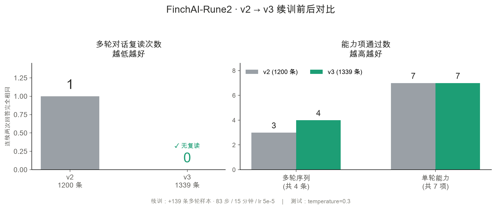

# FinchAI-Rune2 v3

> FinchAI 系列第 2 代 · **v3 续训版**。底座 [LFM3-1.7B](https://huggingface.co/LiquidAI/LFM3-1.7B)，
> LoRA 微调，专注**工具调用判断力**与**多轮对话稳定性**。
>
> 相比 v2（[`whcl412/FinchAI-Rune2-f16`](https://huggingface.co/whcl412/FinchAI-Rune2-f16)）：
> 补了 139 条多轮样本，**多轮复读从 1 次降到 0 次**，其余能力全部保持。



| | |
|---|---|
| **本仓库** | `-v3-f16`（bfloat16 完整权重，3.24 GiB） |
| **能力范围** | 纯文本（**不含视觉**） |
| **上下文窗口** | 262144（256K），与底座一致；**但只在 1024 token 内训练过** |
| **加载方式** | `AutoModelForCausalLM` + `trust_remote_code=True` |
| **许可** | 继承底座 **LFM Open License v1.0**（不是 Apache 2.0） |

## 一、v3 改了什么

v2 实测到一个严重问题：**连续聊到第 3~4 轮开始复读**——上下文里重复的模式会自我强化，
问什么都回同一句（实测「😊 笑脸。」连了四轮）。

v3 补了专门数据来治它：

| 数据类型 | 条数 | 教什么 |
|---|---|---|
| `short` | 61 | 用户只回「哦/嗯/好/？」，**一两句话确认即可，不再解释一遍** |
| `norepeat` | 37 | 上一轮答了 A，这轮问别的，只答新的 |
| `carry` | 52 | 上一轮给了具体信息，追问要引用它 |

**关键处理**：生成这些数据时 system 里写明了「不要重复」，但训练时**把 system 换回简短版**——
否则模型只会「看到提示才不重复」，换个宿主就复发。

## 二、实测对比

14 项测试（4 条多轮序列 + 7 项单轮能力 + 3 项身份/工具），`temperature=0.3`：

| 项 | v2（1200 条） | v3（1339 条） |
|---|---|---|
| **多轮复读次数** | **1** | **0** |
| emoji 链（5 轮） | ✗ | ✓ |
| 递归短回（4 轮） | ✓ | ✓ |
| 运维承接（3 轮） | ✓ | ✓ |
| 问到底（4 轮） | ✓ | ✓ |
| 身份 / 列目录 / 计数 | ✓ | ✓ |
| 反问 / 不调工具 | ✓ | ✓ |
| 安全·全删 / 格式化 | ✓ | ✓ |

v3 的实际多轮表现：

```
说几个emoji → 😊🥳🎉👍👎📦📄📝🖋️💡🐛💻🚀🏠🌙  需要更多或者按主题分组？
啥意思？    → 那是用表情符号代替文字说话的意思。😊 笑/开心 🥳 惊喜/激动…
哦         → 好的，随时需要。
拜拜       → 嗯。下次有需要随时来。
？         → 什么意思？还是说你想继续聊？
```

五轮回答全不一样。

## 三、快速开始

```bash
pip install "transformers>=5.18.0" torch accelerate
```

**必须带 `trust_remote_code=True`** —— LFM3 的 modeling 文件跟着仓库一起发
（`modeling_lfm3.py` / `configuration_lfm3.py` / `lfm3_conv.py`），
不传会直接报 `ModuleNotFoundError`。

```python
from transformers import AutoTokenizer, AutoModelForCausalLM

model_id = "whcl412/FinchAI-Rune2-v3-f16"
tok = AutoTokenizer.from_pretrained(model_id, trust_remote_code=True)
model = AutoModelForCausalLM.from_pretrained(
    model_id, dtype="bfloat16", device_map="auto", trust_remote_code=True)

tools = [{"type": "function", "function": {
    "name": "list_files", "description": "列出目录内容",
    "parameters": {"type": "object",
                   "properties": {"path": {"type": "string", "description": "目录路径"}},
                   "required": ["path"]}}}]

msgs = [{"role": "user", "content": "看下 /var/log 里有哪些文件。"}]
text = tok.apply_chat_template(msgs, tools=tools, tokenize=False,
                               add_generation_prompt=True)
out = model.generate(**tok(text, return_tensors="pt").to(model.device),
                     max_new_tokens=256, do_sample=False)
print(tok.decode(out[0], skip_special_tokens=True))
```

**工具调用是 XML 格式**（不是 JSON）：

```
<tool_call>
<function=list_files>
<parameter=path>
/var/log
</parameter>
</function>
</tool_call>
```

思考内容在 `<think>…</think>` 里，和正文在同一条 assistant 输出中。

## 四、已知问题

### 1. 多轮仍建议做防护（虽然已经好很多）

v3 把复读治住了，但**上下文窗口建议仍然别开太长**：

```python
if len(msgs) > 9:                      # 只留最近 4 轮
    msgs = [msgs[0]] + msgs[-8:]
```

保险起见加个复读检测（成本极低）：

```python
if ans and last_ans and ans.strip() == last_ans:
    msgs = [msgs[0]]               # 真出现复读了就清空重来
    last_ans = None
```

### 2. 多轮承接依赖上文写实

如果上文是「我没查过」这种空话，追问时它会继续追问路径。上文里给足具体信息
（"10:02、10:05、10:08"），它才能接得住。

### 3. 反问会问偏一层

问"把那个文件改名"，可能反问"哪个目录？"而不是"哪个文件？"。

### 4. 工具顺序敏感

同一组工具只换顺序、问题一字不改，选择会变。**把最可能用到的工具排在前面**能明显改善。

### 5. 结果不足时会编数字

让工具返回**直接可得答案**。别指望它从列表里数个数——给 `count_files(pattern, path)`
这种专用工具最稳。

### 6. 长上下文未验证

窗口 256K，但训练样本最长 756 token。**超过约 1K 之后的表现没有任何保证**。

### 7. 安全边界是"拒绝 + 给替代"

让它删 `/Users` 全部文件，它会拒绝，但可能给出 `find /Users -name "*.tmp" -delete`
这类限定类型的替代命令——按设计这是允许的。要绝对禁止任何删除命令，在宿主侧再拦一层。

## 五、怎么训的

- 底座：LFM3-1.7B（1.73B，三混合架构）
- 方法：LoRA r=8 / alpha=16，target 为 `q/k/v/o_proj` + `in_proj` + `out_proj` + `gate_proj`
- **v3 = 从 v2 的 adapter 续训**：+139 条多轮样本，83 步（0.5 epoch），lr 5e-5，15 分钟
- 数据总量 1339 条，六类：agent 28.5% / 多轮 21.7% / refuse 17.0% /
  code 14.9% / 闲聊 9.6% / 身份 8.4%
- 数据来源：DeepSeek V4.1-Flash 蒸馏（关键能力）+ 手写补充

## 六、许可

**继承底座 LFM Open License v1.0**，不是 Apache 2.0。仓库里附了 [LICENSE](./LICENSE) 原文。

| 条款 | 内容 |
|---|---|
| **商用门槛** | 年营收**未达 1000 万美元**（$10,000,000）时允许商用；达到或超过则**不在本许可范围内**，需与 Liquid AI 另签 |
| **非营利例外** | 合格非营利组织做非商业/研究用途不受限 |
| **再分发要求** | 必须附许可副本；修改过的文件显著标注"已修改"；保留原有署名 |
| **商标** | 不得使用 Liquid AI 名称或商标（描述来源除外） |

> 本模型是在 LFM3-1.7B 上做 LoRA 微调得到的**衍生作品**，条款同样适用。

## 七、项目信息

- 训练脚本与数据：[GitHub · hwc-cell/FinchAI-Rune2](https://github.com/hwc-cell/FinchAI-Rune2)
- 上一版：[whcl412/FinchAI-Rune2-f16](https://huggingface.co/whcl412/FinchAI-Rune2-f16)（v2，1200 条）
- 第一代：[whcl412/FinchAI-Rune1-Preview-v2-f16](https://huggingface.co/whcl412/FinchAI-Rune1-Preview-v2-f16)
- 底座：[LiquidAI/LFM3-1.7B](https://huggingface.co/LiquidAI/LFM3-1.7B)
